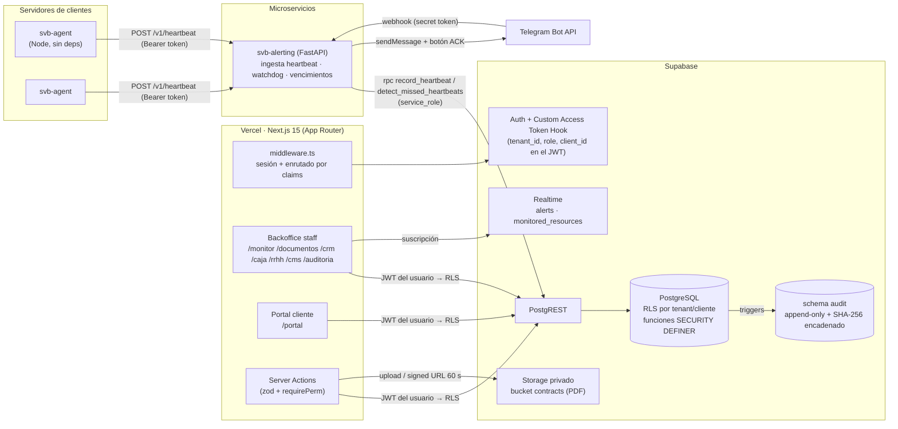
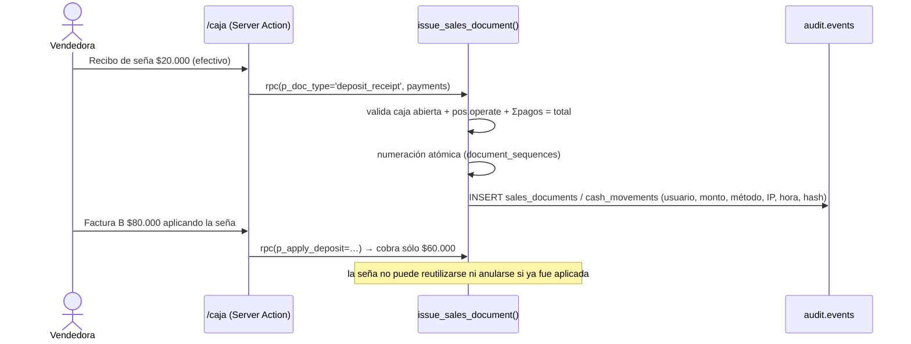

# Arquitectura lógica · Sistema Integral SVB

Plataforma SaaS multi-tenant de **Vincular Business** para operar una empresa de software a medida e IA:
infraestructura de clientes, contratos, CRM/suscripciones, caja, equipo, sitio web y portal de autogestión.

## 1. Vista general



## 2. Capas y responsabilidades

| Capa | Tecnología | Responsabilidad | Regla clave |
|---|---|---|---|
| Presentación | Next.js 15 + React 19 + Tailwind (dark) | UI ejecutiva, Server Components, Server Actions | Nunca usa `service_role`; todo pasa por RLS con el JWT del usuario |
| Enrutado/UX | `middleware.ts` + claims JWT | Clientes → `/portal`; staff → backoffice | Defensa en profundidad: la autorización real está en la base |
| Datos | PostgreSQL (Supabase) | Modelo, reglas de negocio, RBAC, auditoría | Operaciones con dinero o valor legal sólo vía funciones `SECURITY DEFINER` |
| Auditoría | schema `audit` | Registro inmutable de cada cambio | Append-only + cadena SHA-256 por tenant verificable (`audit_verify`) |
| Archivos | Supabase Storage | PDF de contratos versionados | Bucket privado, sin UPDATE/DELETE, URLs firmadas de 60 s |
| Telemetría | `svb-agent` → `svb-alerting` → `record_heartbeat` | Métricas, reglas, alertas | La evaluación de reglas es atómica en SQL; el servicio sólo orquesta y notifica |
| Notificación | Telegram Bot API | Alertas críticas, vencimientos, ACK desde el celular | Webhook verificado con `X-Telegram-Bot-Api-Secret-Token` |

## 3. Multi-tenancy y aislamiento

Dos niveles de aislamiento resueltos 100 % en la base de datos:

```
tenant  (Vincular Business)            ← staff: socios, empleados, vendedores, técnicos
 └── client (Barbería Juan, Club …)    ← usuarios del portal (client_admin / client_user)
```

- Cada tabla de negocio tiene `tenant_id`. Las tablas hijas lo **heredan por trigger** (`tg_inherit_tenant`) desde la fila padre: un usuario no puede "inyectar" otro tenant_id.
- Las políticas RLS usan el patrón `tenant_id in (select public.tenants_with('crm.read'))`, que Postgres evalúa **una vez por consulta** (InitPlan) y aprovecha índices.
- El portal usa `client_id in (select public.my_client_ids())`. Los clientes **no tienen acceso** a `monitored_resources`, `metric_samples`, caja, RRHH ni notas internas de tickets; ven su estado de servicio a través de `portal_service_status()`, que expone sólo nombre amigable, semáforo y uptime.

## 4. RBAC granular

- 21 permisos (`monitor.manage`, `pos.void`, `commissions.approve`, `audit.read`, …) en `permissions`.
- Matriz por rol en `role_permissions` (owner, partner, admin, employee, seller, technician).
- Excepciones por persona en `member_permissions` (conceder o revocar un permiso puntual).
- `my_permissions(tenant)` alimenta la UI; `require_perm()` protege cada función de negocio; RLS protege cada fila.

## 5. Flujos críticos

### 5.1 Venta con seña (POS)


### 5.2 Heartbeat y alertas
1. El agente envía métricas cada 60 s con su token (guardado como `sha256` en la base, rotable con `rotate_agent_token`).
2. `record_heartbeat` inserta la muestra (idempotente por `resource_id+ts`), evalúa reglas de N muestras consecutivas, abre o resuelve alertas (dedupe por *fingerprint*) y actualiza el semáforo.
3. El servicio notifica a Telegram según `min_severity` de cada canal, con botón **"Tomar alerta"** (ACK).
4. Un watchdog cada 30 s marca **DOWN** los recursos que no laten (`interval × missed_beats_down`) y abre alerta crítica.
5. El dashboard se actualiza solo vía Supabase Realtime.

### 5.3 Contratos
`draft → pending_signature → signed → expired | terminated`. Cada PDF sube a `contracts/{tenant}/{client}/{contract}/vN.pdf` con huella SHA-256 calculada en el navegador; `contract_versions` es inmutable. Un contrato firmado no puede cambiar de versión, cliente ni valor. `process_contract_expirations()` renueva los automáticos, vence los demás y genera avisos a 30/15/7 días sin duplicar.

### 5.4 Upgrade de plan
Staff: `change_subscription_plan()` calcula el prorrateo `(precio_nuevo − precio_actual) × días_restantes / días_del_período` y registra el cambio. Cliente: desde el portal, `request_plan_upgrade()` crea un ticket comercial prioritario + interacción CRM.

## 6. Seguridad
- Headers HSTS, X-Frame-Options DENY, nosniff; `poweredByHeader` off.
- `service_role` sólo en el servicio de alertas y jobs; jamás en el navegador.
- `anon` sólo puede ejecutar `submit_lead` y `track_page_view` (landings) y leer páginas publicadas.
- Las tablas-libro (`cash_movements`, `sales_documents`, `contract_versions`, `audit.events`) no tienen permisos de escritura directa y tienen triggers de inmutabilidad.
- IP y User-Agent del usuario final se reenvían a PostgREST para quedar en la auditoría.

## 7. Despliegue sugerido
| Componente | Dónde |
|---|---|
| `apps/web` | Vercel (región `gru1` São Paulo) |
| Base, Auth, Storage, Realtime | Supabase (región `sa-east-1`) |
| `services/alerting` | Fly.io / Railway / VPS con Docker |
| `services/monitor-agent` | systemd en cada servidor del cliente |

## 8. Próximas integraciones
- **ARCA/AFIP**: completar `cae` / `cae_due_date` con `sv.arca.sdk` al emitir facturas A/B/C.
- **pg_cron**: alternativa a los loops del servicio para vencimientos y particiones.
- **Supabase Vault**: mover el token del bot (`secret_ref`) desde variables de entorno.
