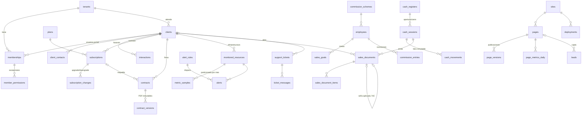

# Esquema relacional · optimizado para auditoría

Migraciones en `supabase/migrations/` (aplican en orden). Pruebas de integración en `supabase/tests/`.

| Migración | Contenido |
|---|---|
| `…01_core` | tenants, profiles, clients, memberships, permisos RBAC, notificaciones, helpers de seguridad |
| `…02_audit` | schema `audit`: eventos append-only, cadena SHA-256 por tenant, verificación |
| `…03_modules` | tablas de los 7 módulos |
| `…04_business_logic` | herencia de tenant, inmutabilidad, triggers de auditoría, funciones de negocio |
| `…05_rls_policies` | RLS de todas las tablas, grants, Storage y Realtime |
| `…06_rbac_catalog` | 21 permisos + matriz por rol |
| `…07_auth_hook` | claims en el JWT, `my_permissions`, `audit_verify`, `dashboard_kpis` |

## Diagrama entidad-relación (resumido)

## Decisiones de diseño para auditoría

1. **`audit.events` append-only.** Trigger que bloquea UPDATE/DELETE/TRUNCATE y sin grants para `anon`/`authenticated`. Cada fila guarda `actor_id`, `actor_role`, `occurred_at` (`clock_timestamp()`), `action`, `old_data`, `new_data`, `changed_cols`, `ip`, `user_agent`, `request_id`.
2. **Cadena criptográfica.** `hash = sha256(prev_hash ‖ contenido)` por tenant, serializada con `pg_advisory_xact_lock`. `audit.verify_chain()` recalcula todo y señala el primer evento alterado, borrado o reordenado (probado en `tests/01_flows.sql`).
3. **Campos denormalizados de caja.** `amount` y `payment_method` viajan en el evento de `cash_movements`: el reporte "quién cobró cuánto, cuándo y cómo" no necesita joins con tablas que pudieran cambiar.
4. **Libros sin UPDATE.** `cash_movements`, `sales_document_items`, `contract_versions` y `page_versions` son inmutables; las correcciones son **reversiones** (`kind='reversal'`, `reverses_id`, única por movimiento).
5. **Comprobantes fiscales.** `sales_documents` sólo admite pasar `issued → voided` (con motivo, usuario y hora) o completar el CAE una vez. Las facturas no se anulan: requieren nota de crédito. Numeración por `(tenant, tipo, punto de venta)` sin huecos por concurrencia.
6. **Caja cerrada = inmutable.** Una sola sesión abierta por registradora (índice único parcial). El cierre guarda saldo esperado, arqueo, diferencia (columna generada) y totales por método; una diferencia exige justificación.
7. **Tiempo real del evento.** `clock_timestamp()` (no `now()`) para que varias operaciones en una transacción conserven su orden real.

## Índices relevantes
- `memberships (user_id) where is_active` → helpers de RLS.
- `audit.events (tenant_id, occurred_at desc)`, `(table_name, record_id)`, `(actor_id, occurred_at desc)`.
- `metric_samples` PK `(resource_id, ts)` + partición mensual (retención = `DROP` de partición).
- `alerts (tenant_id, fingerprint) where status <> 'resolved'` → dedupe de alertas abiertas.
- `contracts (tenant_id, end_date) where status = 'signed'` → job de vencimientos.

## Funciones de negocio (RPC)

| Función | Permiso | Uso |
|---|---|---|
| `open_cash_session(register, opening)` | pos.operate | Apertura de caja |
| `issue_sales_document(session, type, items, payments, …)` | pos.operate | Factura/ticket/recibo/seña con pagos mixtos |
| `void_sales_document(doc, session, reason)` | pos.void | Anulación con reversión de movimientos |
| `register_cash_movement(session, kind, method, amount, ref)` | pos.operate / pos.supervise | Ingresos, egresos, retiros |
| `close_cash_session(session, counted, notes)` | pos.operate | Cierre y arqueo |
| `add_contract_version(contract, path, sha256, size)` | docs.write | Nueva versión PDF |
| `sign_contract(contract, signed_by)` | docs.sign | Firma |
| `change_subscription_plan(sub, plan)` | billing.manage | Upgrade/downgrade con prorrateo |
| `request_plan_upgrade(plan, comment)` | client_admin | Pedido de upgrade desde el portal |
| `calculate_commissions(tenant, start, end)` | hr.manage | Comisiones por tramos de cumplimiento |
| `publish_page(page)` | cms.publish | Publicación versionada |
| `submit_lead(page, …)` / `track_page_view(page)` | anon | Landings públicas |
| `portal_service_status()` | cliente | Semáforo simplificado del portal |
| `record_heartbeat` / `detect_missed_heartbeats` / `process_contract_expirations` | service_role | Jobs del servicio de alertas |
| `audit_feed(tenant, …)` / `audit_verify(tenant)` | audit.read | Consulta y verificación de auditoría |
